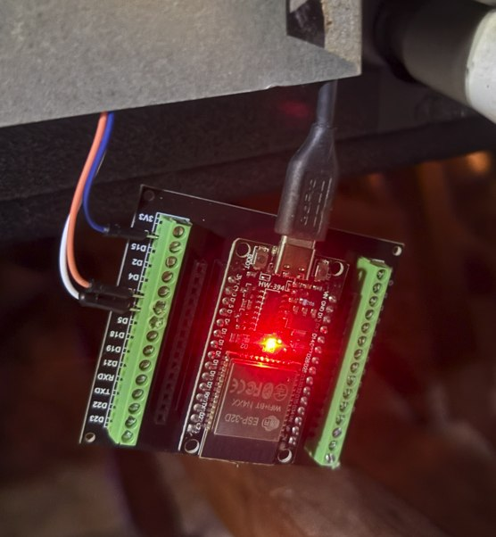
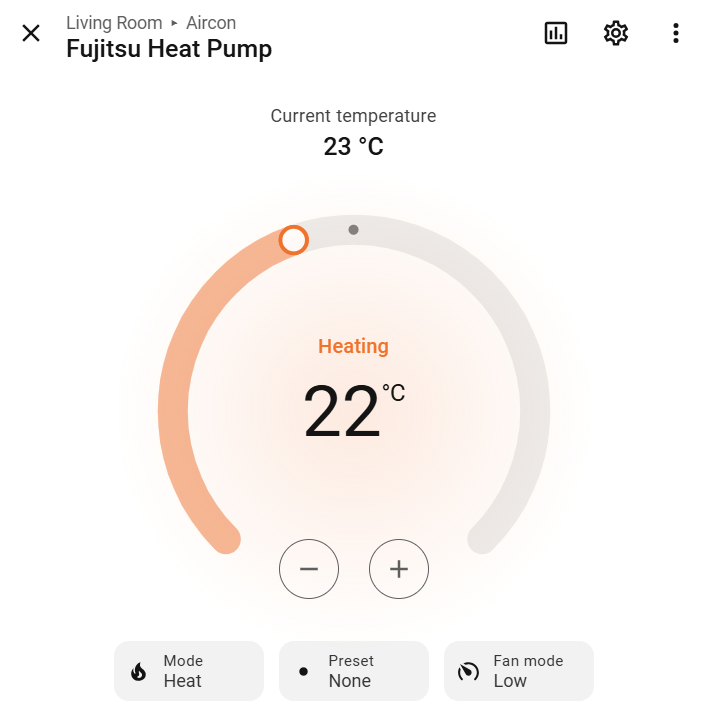
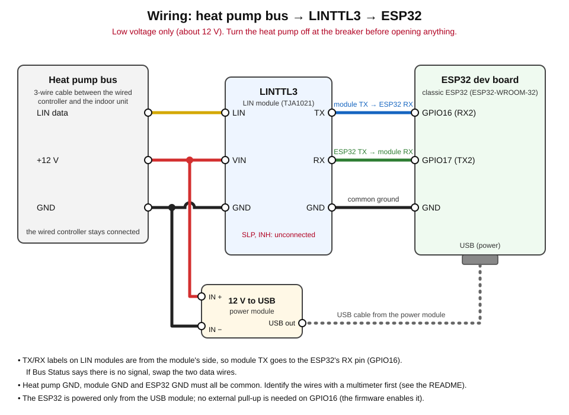
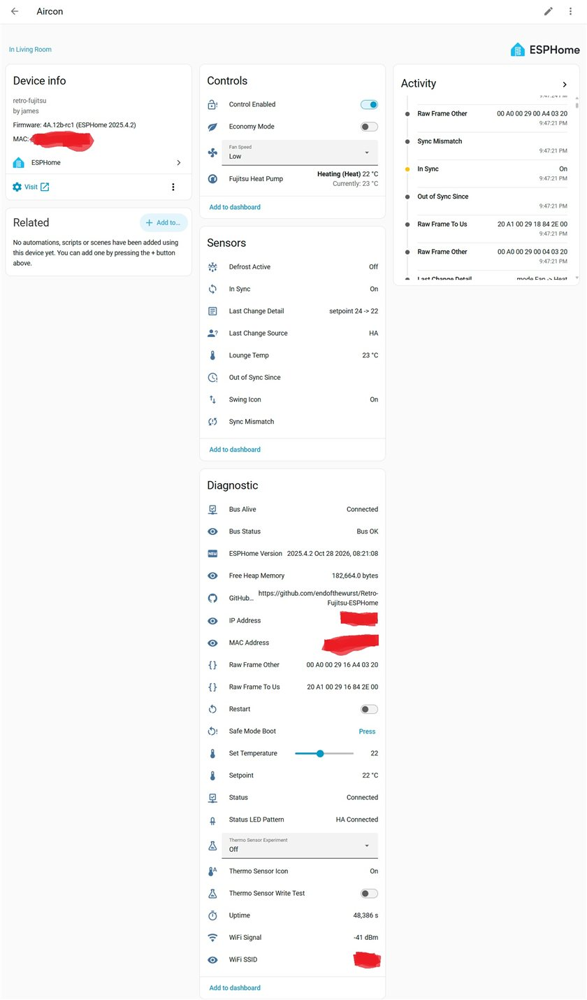

# Retro-Fujitsu-ESPHome

**Local Home Assistant control for Fujitsu heat pumps that only have a wired wall controller.**
An ESP32 and a small LIN module join the controller's 3-wire bus, so Home Assistant gets a normal
climate entity (mode, target temperature, fan speed) while the wall controller keeps working
exactly as before. No cloud, no mains wiring, and nothing inside the heat pump modified. The only change to
existing equipment is one DIP switch inside the wired controller.

> **Status: release candidate 4A.13-rc1.** Developed and tested on one unit (details in
> [Will it work with my unit?](#will-it-work-with-my-unit)). It has run on the author's heat pump
> since October 2026. Compatibility reports from other units are very welcome.

<p align="center">
  
  &nbsp;&nbsp;
  
</p>

---

## What it does

- **Control from Home Assistant:** power, mode (Auto, Cool, Heat, Dry, Fan only), target temperature,
  fan speed (Auto, Low, Medium, High) and Economy.
- **Changes from either side:** a change made at the wired controller shows up in Home Assistant, and a
  change made in Home Assistant shows up on the wired controller.
- **Room temperature as a sensor:** the reading from the wired controller's own thermistor.
- **Defrost detection:** a binary sensor that turns on during a defrost cycle.
- **Who changed it:** *Last Change Source* says whether the last change came from Home Assistant, a
  person at the wall, or a reboot, and *In Sync* shows whether Home Assistant and the unit agree.
- **Kill switch:** an *Aircon Control Enabled* switch drops the ESP32 back to read-only at any time.
- **Local only:** everything runs on your network. ESPHome's web page and over-the-air updates work too.

### The design rule: the ESP32 is never the boss

The wired controller is the primary controller and always keeps full control of the heat pump,
whether or not the ESP32 is powered, on Wi-Fi, or running correct firmware. If the two ever disagree,
the wired controller wins. A person can always walk up to the wall and use the heat pump as if the
ESP32 did not exist.

---

## Why would you want this?

- **Wired-remote units usually have no Wi-Fi.** Commercial interfaces for this kind of unit can cost a
  lot more than the parts here, and some depend on a vendor's cloud servers.
- **It stays local and private.** No account, no subscription, and it keeps working when the
  internet is down.
- **You get the real room temperature.** The wired controller's thermistor reading is the temperature
  the unit actually regulates to. As a Home Assistant sensor it makes room-by-room control (it works
  well with RoomMind) and your own automations much more accurate.
- **You can see why it blew cold.** *Defrost Active* explains the cold air at the start of a heating
  cycle, so you stop wondering whether something is broken.
- **Better automations than a wall timer.** Pre-heat before you get home, turn off when a window is
  opened or everyone leaves, shift usage to your solar surplus, or follow your own schedules.
- **It is family-safe.** Nobody gets locked out: the wall controller always works, and the kill switch
  makes the ESP32 read-only.
- **It tells people and automations apart.** Knowing whether a person or Home Assistant made the last
  change is the first step towards automations that do not fight the humans in the house.
- **Low risk to install.** Three low-voltage wires, one DIP switch and no mains work. It is reversible:
  unplug the ESP32 and flip the DIP switch back, and the system is as it was.
- **It is a good project to learn from.** The bus protocol is documented and the raw captures are in
  the repository if you want to extend it to other models.

### Why you might not want this

- If your unit has an **official, supported Wi-Fi adapter** that does what you need, use that.
- If you are **not comfortable working near electrical equipment**, get an electrician or HVAC
  technician to do the wiring. You are connecting to the heat pump's control bus.
- If you need a **warranty or an installer's sign-off**, check first. Modifying or adding to the control
  wiring may affect either.
- It is a **hobby project tested on one unit**. If you want something that just works out of the box,
  this is not that yet.

---

## Will it work with my unit?

**Tested:**

| Part | Model |
|------|-------|
| Indoor unit | Fujitsu **ART30LUAK** (about 2010) |
| Outdoor unit | Fujitsu **AOT30LMBDL** |
| Wired controller | Fujitsu **AR-3TA3 / UTB-TUB** simple wired remote |
| Microcontroller | ESP32-WROOM-32 (classic ESP32) |

**Worth trying if** your Fujitsu heat pump has a wired wall controller connected by **three wires**
(power, data and ground) to the indoor unit. Fujitsu's wired controllers of this generation are
believed to share the same bus protocol, but that is not confirmed beyond the tested unit.

**Probably will not work if** your heat pump only has an infrared remote, or is a different brand with a
different bus (Mitsubishi Heavy Industries units, for example, are reported to use a different 2-wire bus).

**Untested:** ESP32-S3 and other ESP32 variants, and units other than the one above. The *Contributing* section at the end says how to report your results.

> **Try it safely:** build and test it on the bench first, **not** connected to the heat pump (see the
> Quick start). When you do connect it, watch the first few minutes.

---

## What you need

As a rough guide, allow **a weekend** if you have used ESPHome before, and a bit longer if this is your
first ESP project (that is an estimate, not a measurement). The parts are easy to find on eBay and
AliExpress. They come to a few tens of US dollars in total, but prices vary a lot by seller, so check
current listings.

| Part | What it does | What to search for | Notes |
|------|--------------|--------------------|-------|
| **ESP32 dev board** | The brain: Wi-Fi, ESPHome, Home Assistant | `ESP32-WROOM-32 38 pin development board USB-C`, `ESP32 DevKitC-32` | The tested board is a classic ESP32-WROOM-32. Avoid ESP32-S3 / C3 unless you are happy to experiment. |
| **Screw-terminal breakout** (recommended) | Gives each pin a screw terminal, so there is no soldering and the wiring stays put | `ESP32 38 pin breakout board screw terminal`, `ESP32 expansion board 38P GPIO` | **It must match your board's pin spacing.** Most fit the "38 pin narrow, no mounting holes" boards, not the wider DevKit V1 style. Buy a matching set if you can. |
| **LIN module (LINTTL3)** | Converts the heat pump's LIN bus (about 12 V) to the ESP32's 3.3 V serial | `LINTTL3`, `TTL UART to LIN bus module TJA1021`, `LIN bus converter module 12V 24V` | It must be a **LIN** module, not CAN. The pins are VIN, INH, LIN, GND, RX, SLP and TX. |
| **12 V to USB power module** | Powers the ESP32 from the heat pump's 12 V | `12V to 5V USB buck converter module`, `DC-DC step down 12V to USB 5V 3A` | Make sure the input range covers your bus voltage with margin. Check the listing. |
| **Wire and connectors** | Joins everything up | `Dupont jumper wires female to female`, `wire ferrules`, `lever wire connectors`, `heat shrink` | Plus a USB cable to match the ESP32's port (USB-C or micro-USB). |
| *Optional:* **enclosure** | Keeps dust off and holds it in place | `small ABS project box`, `plastic junction box` | Leave ventilation, and keep it away from heat. |
| *Tools:* **multimeter** | Identifies the wires and checks voltages | any basic digital multimeter | Treat this one as essential. |

Also needed: small screwdrivers, wire strippers, and a computer to flash the ESP32 and run ESPHome.

---

## Skills you need

**Essential**

- **Basic electrical safety.** You will turn the heat pump off at the breaker, open the wired controller
  to set a DIP switch, and work on low-voltage wiring. If the indoor unit is in a ceiling or roof space, take access and footing seriously.
- **Using a multimeter** to check DC voltage and find which wire is which.
- **Following a wiring diagram** carefully, including checking that all the grounds are common.
- **Running a few commands** and editing a text file (your Wi-Fi name and password).
- **Using Home Assistant** well enough to add an ESPHome device.

**Helpful but optional**

- **Soldering.** Most LIN modules ship with pin headers already fitted, so a screw-terminal breakout
  and jumper wires avoid it. Check the listing photos. If the pins are not fitted, you will need to solder.
- Previous ESPHome experience (it makes the flashing steps routine).
- A 3D-printed or off-the-shelf box for a tidy install.

**If you are unsure about any of the essentials,** ask someone who is, or get a professional to do the
wiring. The software side is the easy part.

---

## How it works

```
Fujitsu indoor unit  <->  3-wire bus (LIN, 500 baud)
                              |
                       LINTTL3 module  (12 V LIN <-> 3.3 V serial)
                              |
                       ESP32 + ESPHome  <->  Wi-Fi  <->  Home Assistant
```

The wired controller and the indoor unit talk over a single-wire LIN bus. The ESP32 joins as a
**secondary (slave) controller**: it listens to every frame, publishes the state to Home Assistant, and
when you change something, it sends that change as the reply to the next frame the unit addresses to it.
The wired controller stays on the bus the whole time.

---

## Set the wired controller to Dual mode

The ESP32 acts as a second ("slave") controller, so the wired controller has to be told to expect one.
On the tested unit this is the **"Dual remote controller" DIP switch** inside the wired controller. These
settings come from the Fujitsu ART30LUAK technical manual (section 5-16-6, wired simple remote controller):

| Mode | SW1 | SW2 |
|------|-----|-----|
| Normal (factory setting) | ON | OFF |
| **Dual, master controller (use this)** | **OFF** | OFF |

Leave SW3 to SW6 as they are.

1. Turn the heat pump off at the breaker.
2. Open the wired controller's front case (two screws). Unplug the connector that joins the front case
   to the circuit board before you let the case hang, otherwise the wires can break.
3. Flip **SW1 only** to OFF. Do not touch the other switches.
4. Put the case back together and switch the power on.

**Notes**

- It is reversible. To undo it, flip SW1 back to ON.
- This was discovered while developing the project, and other projects do not document it. On the tested
  unit the wired controller behaved normally in Dual mode, with no error. Whether control also works in
  Normal mode with the current firmware has not been tested, so treat the switch as required.
- **Check your own controller's manual.** Other Fujitsu wired controllers describe a different switch
  arrangement. For example, the generic installation manual for the UTY-RNNUM uses a different switch for
  dual control and marks SW1 as "do not change". Do not change any switch your manual says not to touch.
- How to tell it is set: on the tested unit, the second byte of *Raw Frame To Us* in Home Assistant reads
  **A1** in Dual mode. The development notes record it reading 80 in Normal mode.

---

## Wiring

<p align="center">
  
</p>

> **Turn the heat pump off at the breaker before opening the indoor unit or the wired controller.**
> This is low-voltage work (about 12 V), with no mains wiring, but do not skip this step.

1. **Find the three bus wires.** They run between the wired controller and the indoor unit: about 12 V
   power, the LIN data wire, and ground. You can connect either at the wired controller's terminals or
   at the indoor unit's remote-controller terminals. Use the terminal markings in your unit's manual or
   the controller's installation sheet, then use a multimeter (DC volts) to confirm which wire is
   **ground** and that the supply wire reads about 12 V against it. **Do not guess the order.**
   Connecting the wrong wire to VIN can damage the LIN module. If you are not sure, ask in an issue
   before connecting anything.
2. **Connect in parallel:** the wired controller stays connected. You are adding the ESP32 alongside it.
3. **Bus to the LIN module:** LIN data to **LIN**, +12 V to **VIN**, ground to **GND**. Leave **SLP** and
   **INH** unconnected.
4. **LIN module to the ESP32:** module **TX** to ESP32 **GPIO16 (RX2)**, module **RX** to ESP32
   **GPIO17 (TX2)**, and module **GND** to ESP32 **GND**.
5. **Power the ESP32:** connect the 12 V to USB module's input to the same +12 V and ground, and plug its
   USB output into the ESP32.
6. **Common ground:** the heat pump ground, the LIN module and the ESP32 must all share a ground.

| LIN module | Connects to |
|------------|-------------|
| VIN | Bus +12 V |
| LIN | Bus data wire |
| GND | Bus ground (and the ESP32 GND) |
| TX | ESP32 GPIO16 (RX2) |
| RX | ESP32 GPIO17 (TX2) |
| SLP, INH | Not connected |

**Notes**

- The labels on LIN modules are from the **module's** side of the connection, so the module's TX goes to
  the ESP32's RX pin. If *Bus Status* says there is no signal, swap the two data wires.
- GPIO16 needs a pull-up so it does not float when the board is powered but not wired up. The firmware
  turns it on, so you do not need to add one.
- The bus runs at 500 baud, 8 data bits, even parity, 1 stop bit (8E1), with normal polarity.
- The status LED on GPIO2 (the board's onboard LED) shows the connection state. See
  [docs/FEATURES.md](docs/FEATURES.md) for the patterns.

---

## Quick start

1. **Bench-test first.** Flash the ESP32 and add it to Home Assistant **before** you go near the heat
   pump. A failed flash is then just a USB cable away from recovery.
2. **Install the tools.** You need [Git](https://git-scm.com/downloads) and
   [ESPHome](https://esphome.io/), installed with pip. This version is built and tested on
   **ESPHome 2026.10.1**, so pin it (ESPHome removes things often):

   ```
   pip install esphome==2026.10.1
   ```

   - **Windows:** turn on long paths before the first build (set `LongPathsEnabled` to 1 under
     `HKLM\SYSTEM\CurrentControlSet\Control\FileSystem`, then reboot). The ESP-IDF toolchain that
     ESPHome downloads has paths over 260 characters, and without this the build fails with confusing
     errors. The first build downloads a few GB.
   - Still on **ESPHome 2025.4.2**? Use the tag `esphome-2025.4.2` instead
     (`git checkout esphome-2025.4.2`).
3. **Get the code and add your Wi-Fi details.**

   ```
   git clone https://github.com/endofthewurst/Retro-Fujitsu-ESPHome.git
   cd Retro-Fujitsu-ESPHome
   copy secrets.yaml.template secrets.yaml
   notepad secrets.yaml
   ```

   (On macOS or Linux use `cp` and your editor.) Fill in `wifi_ssid` and `wifi_password`.
4. **Check the config, then flash over USB** (the first time, with the ESP32 plugged into your computer
   and **not** connected to the heat pump):

   ```
   esphome config retrofujitsu.yaml
   esphome run retrofujitsu.yaml
   ```
5. **Add it to Home Assistant:** *Settings, Devices & Services, ESPHome.* The device **Aircon** should
   appear automatically. Click **Configure** and add it.
6. **Set the DIP switch and wire it up** (see above): put the wired controller in Dual mode, then connect
   the ESP32 and power it from the heat pump's 12 V.
7. **Check it is working:**
   - *Bus Alive* is on and *Bus Status* reads **Bus OK**.
   - The room temperature matches the wired controller's display.
   - Changing the mode or fan speed on the wired controller shows up in Home Assistant within seconds.
   - **Then, and only then,** try a change from Home Assistant, such as fan speed, and confirm it
     sticks on the wired controller's display. Control is on by default. If you would like to start
     read-only, turn *Aircon Control Enabled* off first.

**Later updates** can go over the air once the board is installed (`esphome run retrofujitsu.yaml
--device <ip-address>`). Do not reflash over USB while it is wired into the heat pump unless you have to.

> Native ESPHome OTA fails if `logger: level: VERBOSE` is set. Use `curl.exe -F "file=@firmware.bin"
> http://<esp32-ip>/update` in that case.

---

## What you get in Home Assistant

<p align="center">
  
</p>

| Group | Entities |
|-------|----------|
| **Controls** | Fujitsu Heat Pump (climate), Fan Speed, Economy Mode, Aircon Control Enabled |
| **Sensors** | Room Temp, Defrost Active, In Sync, Sync Mismatch, Out of Sync Since, Last Change Source, Last Change Detail, Swing Icon |
| **Diagnostic** | Bus Alive, Bus Status, Setpoint, Raw Frame To Us / Other, Thermo Sensor Icon, Uptime, Free Heap, Wi-Fi signal, ESPHome Version, Restart, Safe Mode Boot |

The full list, what each entity means, and how the *Last Change Source* and *In Sync* logic works are in
[docs/FEATURES.md](docs/FEATURES.md).

### Quiet fan speed is off by default

On the tested unit, Quiet does not work: the indoor unit briefly obeys it, then the wired controller
(which has no Quiet state) overwrites it with High, so the display shows High while the fan runs at
Low. Quiet also cannot be chosen from the wired remote. Quiet is therefore hidden from Home Assistant.
If your unit supports it, set `quiet_fan_mode: true` on the `climate:` block in `retrofujitsu.yaml` and
add `- "Quiet"` to the Fan Speed select.

---

## Known limitations

- **Tested on one unit** and one wired controller (see [Will it work with my unit?](#will-it-work-with-my-unit)).
- **ESPHome version:** tested on 2026.10.1. Other 2026.x releases are untested, and 2026.5.0 or newer
  is expected to be needed. For 2025.4.2 use the tag `esphome-2025.4.2`.
- **Classic ESP32 only** has been tested. ESP32-S3 and others are untested.
- **Fan-only mode has no target temperature**, so the setpoint reads blank there.
- **After a reboot,** *In Sync* can read off while the unit is running, until Home Assistant sets the
  power state.
- **Swing Icon** reads On while the unit is off or in standby (the wired controller hides the icon).
- **Thermo Sensor icon** is read-only: the ESP32 can clear the icon but not set it.
- **Defrost detection** was worked out from one live defrost cycle. A second one is still to be checked.
- **Security defaults:** as shipped, the Home Assistant API is not encrypted, OTA updates have no
  password, and the web page on port 80 has no login. That is common for a trusted home network. If
  yours is not, add ESPHome's `api` encryption key, an `ota` password and `web_server` authentication.
- **Fallback hotspot:** if the board cannot join your Wi-Fi it opens a hotspot called `Aircon-Fallback`
  with the password `fallback123`, which is public in this repository. Change that password in
  `retrofujitsu.yaml` before installing, because anyone in range could otherwise connect while your
  Wi-Fi is down.

---

## Troubleshooting

**No frames / Bus Status says no signal**
- Check the LIN module has power, and that all grounds are common.
- Swap the two data wires: the module's TX should go to the ESP32's GPIO16 (see the notes in Wiring).
- Make sure you are using a LIN module, not a CAN module.

**The values read correctly but changes from Home Assistant do nothing**
- Check the wired controller's DIP switch is set to Dual mode (see above), then try a fan speed change.

**The ESP32 keeps rebooting after flashing**
- If you are bench-testing without the bus connected, check the GPIO16 pull-up is on (the firmware does
  this). Look at the logs over USB.

**The device does not appear in Home Assistant**
- Check the ESP32 is on Wi-Fi (its web page should load), restart Home Assistant, or add it manually
  with the IP address.

**A change in Home Assistant is reverted a moment later**
- On ESPHome 2026.x this needs the reply-timing fix that came with 4A.13-rc1, so make sure you are on
  that version or newer. The details are in [docs/PROJECT-HISTORY.md](docs/PROJECT-HISTORY.md).
- If it still happens, try the fan speed first: it is the best-tested control. Quiet is expected to revert
  (see above).

**Build fails with odd path errors on Windows**
- Turn on long paths (see the Quick start).

**You want to see what the firmware is doing**
- Set `logger: level: DEBUG` in `retrofujitsu.yaml` and watch the logs (`esphome logs retrofujitsu.yaml`).
  You will see control requests and lines such as *Change attributed to HA* or *Human*.

---

## Documentation

- [docs/FEATURES.md](docs/FEATURES.md): every feature and entity, the status LED patterns, and how the Home Assistant page is laid out
- [docs/HARDWARE-NOTES.md](docs/HARDWARE-NOTES.md): the tested hardware, corrections to earlier model numbers, and the UART settings
- [docs/PROTOCOL-SUMMARY.md](docs/PROTOCOL-SUMMARY.md) and [PROTOCOL.md](PROTOCOL.md): the bus protocol, frames and decoded fields
- [docs/PROJECT-HISTORY.md](docs/PROJECT-HISTORY.md): how the project got here, and the roadmap

---

## Credits and references

This project stands on the work of:

- **[Myles Eftos / unreality](https://github.com/unreality/FujiHeatPump):** Arduino library and protocol reverse engineering
- **[jaroslawprzybylowicz/fuji-iot](https://github.com/jaroslawprzybylowicz/fuji-iot):** library for Fuji Electric / Fujitsu units
- **[FujiHeatPump/esphome-fujitsu](https://github.com/FujiHeatPump/esphome-fujitsu):** the original ESPHome custom component
- **[Hackaday: Frederic Germain and Myles Eftos (2017)](https://hackaday.io/project/19473-reverse-engineering-a-fujitsu-air-conditioner-unit):** the first reverse engineering of the Fujitsu LIN bus protocol

Development was done with a lot of help from [Claude](https://claude.ai) (Anthropic).

## Contributing

If you try this on another unit, please open an issue with:

- your indoor and outdoor unit model numbers and your wired controller model
- a photo of the wired controller, and of the controller's terminals if you can
- the ESP32 board and ESPHome version you used
- whether *Bus Status* reached **Bus OK**, and what worked or needed changing

That is how a compatibility list gets built.

## Licence

Apache 2.0. See [LICENSE](LICENSE).

## Disclaimer

This project involves connecting to the control wiring of electrical equipment. Do it at your own risk,
and always turn off power at the breaker before working on the unit. It is not affiliated with or
endorsed by Fujitsu.
